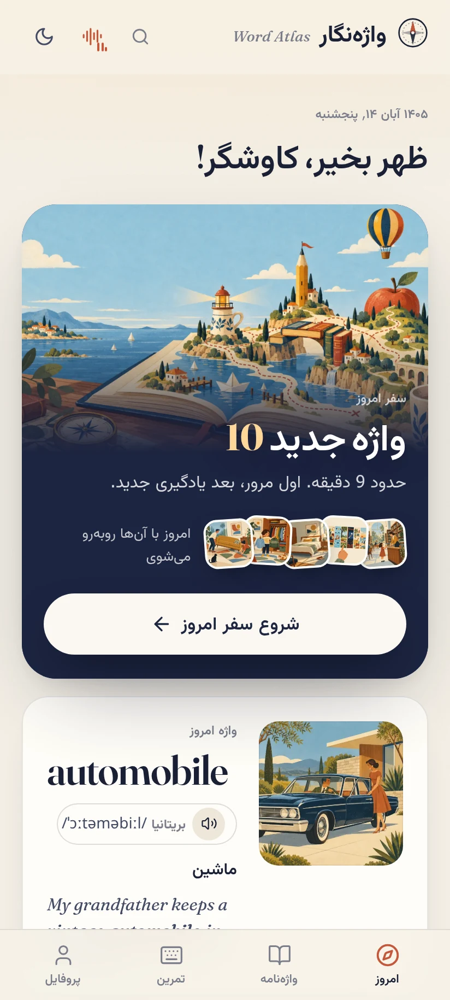

# واژه‌نگار برای اندروید

واژه‌نگار (Word Atlas) واژه‌نامهٔ تصویری انگلیسی به فارسی برای آمادگی آیلتس است: ۷٬۲۹۸ واژه با تصویر، ترجمه، تلفظ بریتانیایی و آمریکایی، مثال و صدای مثال‌ها. این نسخه همان واژه‌نگار وب را به‌صورت اپ اندروید و بدون نیاز به مرورگر اجرا می‌کند.

- سفر روزانه: هر روز ۱۰ واژهٔ تازه، همراه با مرور فاصله‌دار
- واژه‌نامه با فیلتر سطح A1 تا C2 و جست‌وجو
- تمرین و مرور، واژهٔ روز و دسته‌بندی موضوعی
- دانلود آفلاین هر سطح برای استفاده بدون اینترنت

نسخهٔ نصبی از بخش Releases دریافت می‌شود.
